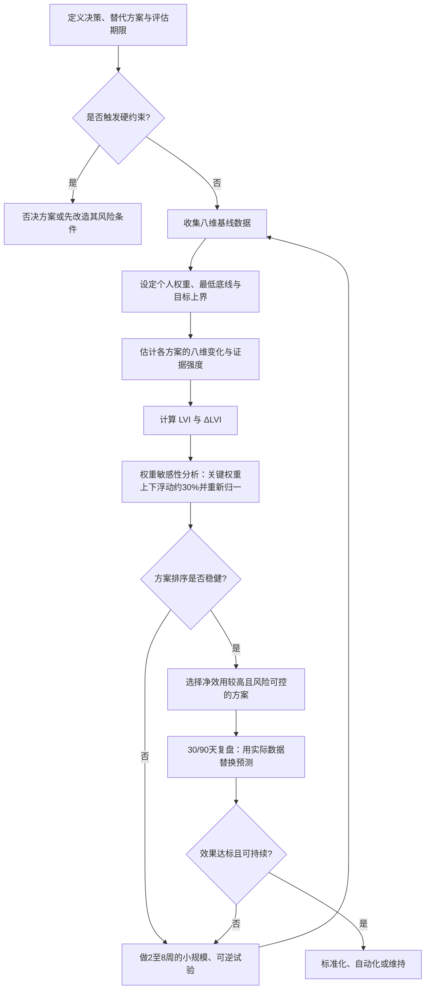

# “性价比人生”概念与可操作指南：从网络热词到可量化个人决策框架

## 执行摘要

截至 **2026年10月11日**，中文互联网近期快速传播的“高性价比人生”思路，一个最明确的载体是开源项目 **HowToLiveBetter /《高性价比人生指南》**。该项目当前列出 **677条建议**，GitHub 页面显示约 **5.95万 Stars、4900 Forks**；其核心做法不是笼统讲“自律”，而是对每项建议分别标明成本、收益、证据强度和原始出处，并强调这是“备选单而非任务清单”。更重要的是，原项目明确拒绝把寿命、金钱、时间精力、人身自由等不同结果强行兑换成同一种单位。citeturn21view0

从本次文献检索看，**“性价比人生”目前不是心理学、经济学或公共卫生学中已经标准化、验证过的学术构念**。更严谨的理解，是把一个互联网原生概念拆解为若干已有研究基础的构念：时间贫困、主观幸福感、健康行为、职业适应力、社会资本、财务安全、尾部风险、行为可持续性，再利用多准则决策分析的思想把它们组织起来。多准则决策分析本来就是为多个相互冲突目标的决策而设计；相关系统综述也表明，线性加权是常用方法，但评分尺度、权重设定、透明性和敏感性分析会显著影响最终结果。citeturn16search0turn16search8

因此，本报告把“性价比人生”定义为：

> **在法律、基本健康、基本财务安全和核心照护责任等硬约束不被突破的前提下，把有限的时间、金钱、注意力、体力和机会成本，配置到能够持续提升健康、心理幸福感、职业资本、关系质量及抗风险能力的事项上，最大化单位稀缺资源的长期净效用。**

这一定义直接排除一个常见误解：**“性价比高”不等于“便宜”。** 花更多钱缩短通勤、购买家务服务、选择更健康但略贵的生活方式，完全可能比“省钱”更高性价比。跨国研究发现，用钱购买节省时间的服务与更高生活满意度相关，一项现场实验中，工作成年人在时间节省型消费后的幸福感也高于等额物质消费。与此同时，自由时间并非简单“越多越好”：美国大样本研究发现自由时间与主观幸福感呈非线性关系，极少自由时间明显不好，极多但缺乏目的的自由时间也未必继续增加幸福感。citeturn18search0turn18search1

本报告给出一个个人可操作的八维模型：

| 维度 | 默认权重 |
|---|---:|
| 时间投入 | 15% |
| 金钱成本 | 15% |
| 心理幸福感 | 15% |
| 健康 | 20% |
| 职业发展 | 10% |
| 社交/家庭 | 10% |
| 长期风险 | 10% |
| 可持续性 | 5% |

核心不是追求某个“人生总分”，而是按三层顺序决策：

**硬约束否决 → 八维比较 → 权重敏感性分析与可逆试验。**

本报告构造的生活资源配置指数记为 **LVI（Life Value Allocation Index）**：

\[
LVI=\frac{\sum_{i=1}^{8}w_i S_i}{100}
\]

其中 \(S_i\) 为各维度0–100分，\(w_i\) 为百分比权重。真正用于选择方案的是：

\[
\Delta LVI=LVI_{\text{方案后}}-LVI_{\text{基线}}
\]

这一指标是**工程化决策仪表盘，不是经过心理测量学验证的“人生量表”**。不要把72.4分理解成比69.8分“科学地幸福2.6分”；当差异很小时，应停止争论小数点，改做2–8周的低成本、可逆试验。

中国数据也说明为什么不能只看工资。国家统计局第三次全国时间利用调查覆盖31个省区市及新疆生产建设兵团，调查约3.85万户、10.7万人；时间被正式分为生理必需、有酬劳动、无酬劳动、个人自由支配、学习培训和交通等领域。2025年全国居民人均可支配收入为43,377元、人均消费支出29,476元，但城乡差异明显，所以全国平均数只适合做宏观背景，不适合作为个人“合格收入线”。citeturn16search7turn16search3turn17search2

**本报告最终结论：性价比人生不是“把自己活成Excel”，而是防止人生被单一指标绑架。** 真正优先级最高的，通常不是继续压缩零碎消费，而是修复那些**高频发生、长期累积、影响多个维度、且能够以低成本改变的结构性摩擦**：过长通勤、长期睡眠不足、无边界加班、现金流脆弱、收入来源过度集中、关系长期失养、不可持续的自律系统。

完整PDF、CSV、图表和Mermaid源文件已经生成：

**[下载完整 PDF 报告](sandbox:/mnt/data/xingjiabi_life/xingjiabi_life_report.pdf)**  
**[下载全部研究材料 ZIP](sandbox:/mnt/data/xingjiabi_life_research_package.zip)**  
**[下载可编辑 Markdown 全文](sandbox:/mnt/data/xingjiabi_life/xingjiabi_life_report.md)**

## 概念、来源与研究方法

“性价比人生”的流行版本，至少包含四种不同思想。如果不先区分，很容易把“极简”“省钱”“幸福”“循证决策”混为一谈。

| 解读 | 核心问题 | 优点 | 主要缺陷 |
|---|---|---|---|
| 极简/节流型 | 怎样花最少的钱？ | 简单、立刻可执行 | 容易忽略时间、健康与机会成本 |
| 网络循证型 | 哪些行为低投入、高收益且有证据？ | 强调原始来源与成本收益 | 不同结果难以统一比较 |
| 幸福/时间型 | 什么配置真正改善生活体验？ | 纳入情绪、自由时间和关系 | 主观性较强，个体差异大 |
| 本报告的多维决策型 | 在个人约束下哪一方案长期净效用最高？ | 能处理工资、健康、家庭等冲突 | 需要自己设权重，存在模型误差 |

《高性价比人生指南》的突出贡献恰恰是**把“证据强度”和“性价比”分开**：一项建议的结论非常可信，并不自动意味着它对每个人都值得做；同时，该项目把不同收益口径分开比较，承认“降低死亡风险”和“每年省500元”没有客观统一兑换率。其现有版本还明确提示内容可能过时、政策存在地区差异，医疗、法律等现实决策应以当地专业意见为准。citeturn21view0

这也是本报告没有直接创造一个“人民币化人生价值函数”的原因。相反，本报告采用类似多准则决策分析的结构：**每个维度内部标准化，跨维度只用个人权重表示偏好，而且在综合评分之前设硬约束。** MCDA系统综述显示，多准则方法已经广泛用于具有安全、成本、质量等冲突目标的复杂决策，约一半相关研究采用线性加总模型；同时，研究者也反复提醒，评分、赋权和敏感性分析方法本身需要透明说明。citeturn16search0turn16search8

在时间方面，国内心理学研究提出，所谓时间贫困不应只理解为“空闲小时数少”，而应同时考虑时间的**数量、强度/节奏和质量**；过度的生产率导向还可能把注意力从活动体验转向任务完成，对个人、人际及家庭幸福感产生影响。citeturn16search2turn16search6

这与国家统计局的时间利用框架具有现实呼应。2024年第三次全国时间利用调查显示，中国居民的生活可以明确拆分为劳动、无酬劳动、交通、自由支配等预算；调查还显示互联网使用已经占据大量日常时间，但互联网活动可能与其他活动重叠，因此不能简单把各类小时相加。citeturn16search3turn16search7

在消费观念上，主流媒体转载的年轻消费研究也显示，“性价比”正在和所谓“心价比”、情绪价值共同出现，即人们并不只评价现金价格，也评价性能、耐用性和消费带来的主观体验。这类行业调查不能等同于同行评审研究，但可以说明“性价比”这一词在大众语境中已经从单纯低价扩张到综合价值判断。citeturn15search2

**证据使用原则。** 本报告按以下顺序处理信息：政府统计、法律法规和公共卫生机构优先；其次是同行评审论文、系统综述和纵向研究；再次是主流媒体与行业报告；最后才是互联网开源项目及个人资料。案例中的“优化后分数”均为**情景演示值，而非科学预测的平均治疗效应**。

## 指标体系与评分模型

所有指标首先转成0–100分。正向指标可用：

\[
N^+(x;L,U)=100\times clip\left(\frac{x-L}{U-L},0,1\right)
\]

成本型指标反向计算：

\[
N^-(x;L,U)=100\times clip\left(\frac{U-x}{U-L},0,1\right)
\]

其中 \(L\) 是个人最低参考点，\(U\) 是目标点。**L、U不是全国统一标准。** 例如，健康指标要服从个人疾病情况和医疗建议；现金储备也必须结合就业稳定性、家庭责任和社会保障，而不能机械套一个月份。

八个维度的完整操作定义如下。

| 维度 | 可量化指标 | 维度内评分建议 | 示例计算 | 示例分 |
|---|---|---|---|---:|
| **时间投入 15%** | 自主可支配时间h/周；时间自主性0–10；通勤+无偿加班h/周；≥90分钟整块时间次数 | 40%自主时间 + 25%自主性 + 20%反向时间负担 + 15%整块时间 | 自主12h，个人区间5–20h→46.7；自主性7→70；通勤加班7h、0–15h反向→53.3；整块3/5→60 | **55.8** |
| **金钱成本 15%** | 自由现金流率；必要支出率；决策成本/年收入；金钱压力0–10 | 50%现金流 + 30%必要支出反向 + 20%低压力 | 自由现金流25%、30%为目标→83.3；必要支出60%、50–90%区间→75；压力4/10→60 | **76.2** |
| **心理幸福感 15%** | WHO-5；生活满意度0–10；主观压力0–10 | 60%WHO-5 + 20%满意度 + 20%低压力 | WHO-5映射52；满意度6.5→65；压力6→40 | **52.2** |
| **健康 20%** | 睡眠时长与规律；身体活动min/周；基础健康风险控制；自评功能 | 30%睡眠 + 25%活动 + 20%风险控制 + 25%功能 | 睡眠项60；活动90/150min→60；风险控制80；功能7/10→70 | **66.5** |
| **职业发展 10%** | 可迁移技能；外部市场性；收入/职责成长；岗位匹配与意义 | 30%技能 + 30%市场性 + 20%成长 + 20%匹配 | 70、65、55、70 | **65.5** |
| **社交/家庭 10%** | 核心关系满意度；受保护高质量时间；可靠支持；照护分工公平 | 40%质量 + 30%时间 + 20%支持 + 10%公平 | 75、75、80、70 | **76.0** |
| **长期风险 10%** | 流动性缓冲；高息债务；保障缺口；收入集中度；方案可逆性 | 35%流动性 + 25%债务安全 + 20%保障 + 20%分散/可逆 | 缓冲4/6月→66.7；债务80；保障70；分散50 | **67.3** |
| **可持续性 5%** | 90天执行率；维护负担；依赖意志力程度；可逆性 | 40%执行率 + 30%低维护负担 + 30%可逆性 | 执行75；负担4/10反向→60；可逆性8/10→80 | **72.0** |

**时间维度。** 不应只统计“工作多少小时”。同样10小时自由时间，10个零碎的一小时与5个完整两小时的效用可能不同；时间自主性也与单纯时长不同。国内时间贫困研究正是因此强调数量、节奏与质量的多维结构。citeturn16search6

另一个实用指标是**有效时薪**：

\[
有效时薪=
\frac{税后劳动收入-直接工作成本}
{工作时间+通勤时间+无偿待命/恢复成本时间}
\]

例如月税后收入15,000元，表面工作176小时，但通勤40小时、额外无偿加班24小时，则忽略其他成本时的有效时薪约为：

\[
15000/(176+40+24)=62.5元/小时
\]

因此，一个工资提高10%、但每周额外消耗15小时的职位，实际性价比完全可能下降。

中国《劳动法》规定，标准制度下劳动者每日工作时间不超过8小时、平均每周不超过44小时，并要求每周至少休息一日；延长工作时间一般每日不得超过1小时，特殊情况下每日不得超过3小时且每月不得超过36小时。现实劳动制度还存在其他经批准的工时安排，因此个人判断既要看实际负荷，也要区分具体适用制度。citeturn17search0

基于2018年中国家庭追踪调查的研究发现，工作时间与工作满意度呈非线性关系，超过约9小时/日后满意度下降，超过12小时下降更明显；已婚与未婚、女性与男性、自雇与受雇者之间效果并不相同，而且身体健康在部分关系中起中介作用。这进一步说明不能用一个统一“最优工时”套所有人。citeturn19search2turn19search1

**心理幸福感。** WHO-5是世界卫生组织提供的简洁心理幸福感自评工具，由5个针对过去两周状态的问题组成，各项采用6级评分，高分代表更好的心理幸福感，并已有中文版本。citeturn16search1turn16search5

本报告只把其结果**线性映射到0–100作为仪表盘显示**，不改变其量表含义：

\[
WHO5_{dashboard}=\frac{原始总分}{最高可能总分}\times100
\]

这里尤其要避免一种“高性价比陷阱”：把所有非生产时间视为浪费。研究显示，自由时间过少与较低幸福感相关，而极多但缺少有意义活动的自由时间也不一定继续提高幸福感。citeturn18search1

**健康。** 健康应得到相对高的默认权重，因为健康不仅本身有价值，还会影响时间、工作能力、情绪和长期财务风险。中国疾控居民指导建议成年人每周至少进行约150分钟中等强度身体活动，并减少持续久坐。citeturn17search1

健康评分必须设置“底线优先”，不能出现“长期睡眠不足扣20分，但涨薪加25分，所以值得”的机械补偿。涉及慢性病、孕产、药物、精神健康等情况时，加权模型不能替代专业医疗判断。

**职业发展。** 工资只是职业价值的一部分。本报告同时计算：技能是否能迁移到别的公司或行业、是否拥有外部市场需求、是否积累作品/证书/客户、收入来源是否高度依赖一个组织。对338名中国员工的三时点研究发现，职业适应力能够预测工作投入，而工作投入又与员工幸福感相关，说明“职业资本”比当期工资更适合进入长期模型。citeturn18search3

可以建立一个简单的**职业期权分**：

\[
CareerOption=
0.35Skill+
0.30Marketability+
0.20Network+
0.15IncomeGrowth
\]

对于二三十岁的职业起步阶段，这个指标通常应比职级头衔本身权重更高。

**社交与家庭。** 这一维度不能简单用“微信好友数”衡量。基于2016年CFPS、26,009名大陆成年人样本的研究发现，信任、互惠、邻里关系等认知型社会资本与生活满意度存在显著关系，而单纯结构性社会参与的稳健性更弱。citeturn18search2

因此优先记录的是：是否有2–5个真正可调用的支持者；伴侣/家庭关系满意度；每周不受工作干扰的高质量共处时间；照护责任是否长期由一人承担。

**长期风险。** 与收益不同，风险必须特别处理尾部事件。最简单的是设置：

\[
RiskBuffer=
Liquidity\times0.35+
DebtSafety\times0.25+
Coverage\times0.20+
Diversification\times0.20
\]

但任何可能导致破产、违法、严重健康损害或无法逆转职业损失的方案，都应进入“硬约束审核”，而不是靠提高其他分数补偿。

**可持续性。** 性价比不是“理论收益/理论成本”，而是：

\[
实际性价比 \approx 理论净收益\times实际执行率
\]

一个理论上100分、只能坚持10%的方案，长期可能不如一个70分、能自动执行90%的方案。因此默认设置、自动转账、固定时间块、减少决策次数，通常比依靠每日意志力更值得优先。

为避免伪精确，可暂用以下仪表盘区间，但这**只是本报告设定的管理阈值，不是经验证的医学或心理学界线**：

| LVI | 解释 |
|---|---|
| 75–100 | 当前资源配置总体较强，重点处理最低板 |
| 60–74 | 可运行，但存在明显改进空间 |
| 45–59 | 高摩擦或脆弱状态，应优先修复结构问题 |
| <45 | 不宜继续优化细枝末节，先处理核心底线 |

另一个重要原则是**避免重复计分**。例如，应急金只在“长期风险”中计主要分，不要又在“金钱”维度把同一件事加一次；运动对心理可能有外溢收益，但不应把同一个运动分钟同时完整算成健康100分和心理100分。

## 人群权重与调参

权重没有“科学唯一答案”。权重表达的是：**当两个好东西冲突时，你现在最不能牺牲什么。**

| 人群 | 时间 | 金钱 | 心理 | 健康 | 职业 | 社交/家庭 | 风险 | 可持续 |
|---|---:|---:|---:|---:|---:|---:|---:|---:|
| 默认职场成人 | 15 | 15 | 15 | 20 | 10 | 10 | 10 | 5 |
| 单身青年 | 15 | 15 | 15 | 15 | **20** | 8 | 7 | 5 |
| 已婚有孩中年 | 12 | 12 | 12 | **20** | 8 | **18** | **13** | 5 |
| 自由职业者 | 15 | 15 | 12 | 15 | 12 | 8 | **18** | 5 |
| 低收入/高债务 | 10 | **25** | 10 | 15 | 10 | 10 | **15** | 5 |
| 高收入/时间贫困 | **25** | 8 | **18** | **20** | 8 | 10 | 6 | 5 |
| 50岁以上/照护责任重 | 12 | 10 | 12 | **25** | 5 | **18** | **13** | 5 |

[下载可编辑权重 CSV](sandbox:/mnt/data/xingjiabi_life/weights_profiles.csv)

这里应特别注意：**年龄本身并不直接决定权重。约束才决定权重。**

一个27岁的重病患者，健康权重可能高于55岁的健康高管；一个45岁但没有家庭负担、资产充足的人，其家庭和财务风险权重可能远低于同龄的单收入三孩家庭。因此更好的调参规则是：

| 状态变化 | 权重如何调整 |
|---|---|
| 收入刚覆盖必要支出 | 金钱、风险上调；体验型消费下调 |
| 高息债务存在 | 金钱、风险进入近似硬约束 |
| 收入较高但每天严重缺时间 | 时间、健康、心理上调 |
| 有婴幼儿/老人需要长期照护 | 家庭、时间、风险上调 |
| 刚进入职业快速成长期 | 职业资本上调，但不能突破健康底线 |
| 自由职业/创业 | 风险、现金流、可持续性上调 |
| 身体出现持续异常 | 健康直接进入硬约束，不再只是20% |
| 接近退休或职业资本边际收益下降 | 职业权重下降，健康、关系、时间上调 |

### 权重敏感性

对最终结论至少做一次简单压力测试：

假设原权重为：

\[
w=(15,15,15,20,10,10,10,5)
\]

把最重要的两个争议权重分别上下浮动 **约30%**，然后重新归一，使总和仍为100。

若A、B两个方案原本：

\[
LVI_A=72,\quad LVI_B=69
\]

但时间权重稍微提高后B变成73、A变成70，这说明“选A”并不是稳健结论。正确行动不是继续精细计算，而是找到造成排名翻转的那个变量，进行现实试验。

对于住房、跳槽、婚育、创业等高锁定决策，应特别增加一个：

\[
ReversibilityScore
\]

即“后悔之后退回原状态有多容易”。相同预期效益下，**可逆方案优先于不可逆方案**。

## 案例与可视化

以下三个案例全部是**假设性案例**。数字用于展示评分过程，不代表对具体个人的预测。

**单身青年：该不该多花房租搬近公司**

原始条件：

| 项目 | 基线 |
|---|---:|
| 年龄 | 27 |
| 月税后收入 | ¥11,500 |
| 当前通勤 | 约8.3h/周 |
| 加班 | 约8h/周 |
| 自主时间 | 约10h/周 |
| 睡眠 | 6.4h/夜 |
| 身体活动 | 60min/周 |
| WHO-5仪表盘分 | 52 |
| 储蓄 | ¥50,000 |

方案为搬近公司，月租增加 **¥1,200**，每周减少约 **5小时**通勤，把大部分时间转为睡眠、运动和完整自由时间。按照单身青年权重：

| 维度 | 基线 | 搬近后目标 |
|---|---:|---:|
| 时间 | 48 | 76 |
| 金钱 | 72 | 62 |
| 心理 | 52 | 64 |
| 健康 | 48 | 66 |
| 职业 | 66 | 68 |
| 社交 | 58 | 64 |
| 风险 | 70 | 66 |
| 可持续 | 56 | 68 |
| **LVI** | **58.54** | **66.94** |

\[
\Delta LVI=+8.40
\]

年度现金成本约增加：

\[
1200\times12=14,400元
\]

年度买回时间约：

\[
5\times52=260小时
\]

于是单看房租很像“消费升级”，换一个单位就不同：

\[
14400/260\approx55.4元/买回小时
\]

当他的实际税后有效时薪明显高于这一水平，而且这些时间真的能变成睡眠、运动和完整自由时间时，搬近的合理性很强。用金钱购买时间改善幸福感至少与既有行为研究方向一致，但具体效果仍必须用个人实测验证。citeturn18search0

图解：**金钱分下降，但时间、健康、心理与可持续性一起抬升。** 这比“房租便宜就是划算”更接近真实资源交换。

建议不是立刻签长期高锁定合同，而是先使用短租、可转租或其他低锁定方案进行约8周测试：实际记录通勤节省、睡眠、运动和情绪。如果每周声称节约5小时，最后只是多刷5小时短视频，原来的收益预测应被下调。

**已婚有孩中年：加薪晋升是不是一定划算**

假设42岁，夫妻税后合计 **¥35,000/月**，按揭¥9,000，必要支出约¥22,000，应急金¥180,000，目前工作约47h/周，家庭关系质量8/10。

有三个方案：

| 维度 | 保持当前 | 直接晋升 | 有边界的协商晋升 |
|---|---:|---:|---:|
| 时间 | 65 | 35 | 62 |
| 金钱 | 68 | 82 | 78 |
| 心理 | 68 | 50 | 70 |
| 健康 | 72 | 52 | 70 |
| 职业 | 70 | 86 | 84 |
| 家庭 | 82 | 48 | 78 |
| 风险 | 78 | 72 | 78 |
| 可持续 | 70 | 45 | 68 |
| **LVI** | **72.52** | **57.57** | **73.50** |

直接晋升条件是假设税后增加约¥8,000/月，但额外工作 **15h/周**、每月出差3晚。其结果是：

\[
\Delta LVI=-14.95
\]

这就是典型的“工资ROI高、人生ROI低”。

中国CFPS研究已经发现，长工作时间与工作满意度存在明显非线性关系，并且已婚员工受到长工作时长影响的模式不同于未婚者；研究也提示身体健康会参与这一关系。citeturn19search2

第三个方案不是拒绝晋升，而是**重写交易条件**：税后只增加约¥5,000/月，但把额外工作控制在约6h/周、每月最多1次出差、固定每周弹性或居家安排，并尽量使条件制度化而非依赖领导口头承诺。

这样：

\[
LVI=73.50
\]

仅比当前提高 **0.98分**。这意味着结论并不是“晋升很好”，而是：

> **只有边界条件真正成立时，晋升才勉强优于维持现状；如果边界无法执行，维持现状明显优于裸晋升。**

这一案例揭示“性价比人生”的核心：**职业机会不是单变量优化题。**

**自由职业者：收入不错，为什么依然低性价比**

假设35岁自由职业者：

| 项目 | 基线 |
|---|---:|
| 月均净收入 | ¥25,000 |
| 最大客户收入占比 | 60% |
| 工作时长 | 55h/周 |
| 回款周期 | 约2个月 |
| 流动性缓冲 | 约2个月 |
| 身体活动 | 80min/周 |

基线维度为：

\[
(38,72,56,52,74,50,34,42)
\]

在自由职业者权重下：

\[
LVI=52.12
\]

虽然“职业”和“金钱”看起来不错，但真正的问题在于：最大客户一旦消失，收入立刻发生结构性断裂；回款慢；病一天可能就少一天收入；工时高度侵占恢复时间。

优化方案：

淘汰低时薪、反复修改、高沟通成本客户；新单报价提高约15%；第一大客户收入占比逐步压低到 **35%以下**；每周目标释放约10小时；每笔回款自动把20%转入缓冲账户，直到达到个人设定的安全月份；结合实际身份补齐适用的社会保障和风险保障。

情景目标维度：

\[
(70,70,68,68,80,58,72,70)
\]

于是：

\[
LVI=70.06
\]

\[
\Delta LVI=+17.94
\]

它的本质并不是“少挣钱、躺平”，而是把风险从“我以后注意点”改造成**定价机制、客户组合和资金账户规则**。

[下载三个案例完整评分 CSV](sandbox:/mnt/data/xingjiabi_life/case_scores.csv)

**成本—效益散点图**

下面把几个方案放在同一张图里。横轴是**年度现金净成本**，负值代表反而增加收入；纵轴是 **ΔLVI**；气泡大小表示年度净时间变化的绝对规模。

[下载散点图可编辑 CSV 数据](sandbox:/mnt/data/xingjiabi_life/cost_benefit_scatter_data.csv)

图的阅读逻辑：

| 区域 | 含义 |
|---|---|
| 左上 | 现金上更好，人生综合效益也提高，最理想 |
| 右上 | 花钱换来更高综合效益，典型如有效“买回时间” |
| 左下 | 虽然挣钱更多，但整体人生效益下降 |
| 右下 | 又花钱又恶化，应优先排除 |

“直接晋升”落到下方，正是因为**加薪不是福利的充分统计量**；“搬近公司”虽然处于现金成本为正的区域，却可能因为大量买回时间而得到正的综合收益。

这些图表的视觉设计正式排版时建议固定映射：基线用中性灰，优化后用蓝/青色；危险硬约束用红色；健康/恢复类用绿色。不要给八个维度各用一种艳色，会降低比较效率。雷达图尽量只比较2–3个方案；超过3条曲线改用热力表。

## 决策流程与执行清单

个人真正使用时，不需要每次都填一张复杂表。以下流程足够覆盖跳槽、搬家、买车、读研、健身、外包家务、婚育、自由职业定价等大部分问题。

[下载 Mermaid 流程图源文件](sandbox:/mnt/data/xingjiabi_life/decision_flowchart.mmd)

其中**硬约束**至少包括五类：

| 硬约束 | 处理原则 |
|---|---|
| 明显违法或严重合规风险 | 不进入常规加权交易 |
| 高概率严重健康损害 | 先改变条件，不能靠工资抵消 |
| 基本现金流可能断裂 | 先恢复偿付能力 |
| 不可逆且存在灾难性下行 | 优先缩小试验规模或增加退出机制 |
| 核心家庭/照护责任无法履行 | 把家庭底线显式写进方案 |

这恰好修正“性价比思维”最危险的一面：**不是所有东西都应该拿来交换。**

日常实践可压缩成一张月度仪表盘：

| 每月只记录 | 建议数据 |
|---|---|
| 时间 | 工作、通勤、照护、自主完整时间 |
| 钱 | 税后收入、必要支出、自由现金流 |
| 心理 | WHO-5或固定的幸福/压力量表 |
| 健康 | 睡眠、运动、重要健康指标 |
| 职业 | 新增技能、市场反馈、收入集中度 |
| 关系 | 受保护家庭时间、关系满意度 |
| 风险 | 缓冲月份、债务、重大单点风险 |
| 可持续 | 上月设定行为实际完成率 |

随后使用一个极简规则：

> **每季度只处理一个“最低板”和一个“最大摩擦”。**

不要同时优化八项。原开源指南本身也明确强调它是一张候选清单，而不是要求读者完成全部建议。citeturn21view0

对于时间贫困者，优先顺序通常是：

**删除 → 缩短 → 批处理 → 自动化 → 外包 → 最后才是要求自己更努力。**

其中“花钱买时间”不应按照消费金额判断，而应计算：

\[
买回时间单价=\frac{新增现金成本}{真实释放时间}
\]

再和你的**税后有效时薪**以及这些时间的预期用途比较。

例如家务外包每月1000元、真实释放10小时：

\[
100元/小时
\]

如果你的有效时薪只有50元，而且释放时间最后被无意义消耗，未必划算；如果有效时薪为250元，且释放时间稳定用于睡眠、育儿或高价值工作，则结论可能完全相反。研究所能提供的是“购买时间可能提高幸福感”的平均方向，不能替代个人机会成本计算。citeturn18search0

对于健康维度，不应追求复杂指标。国家公共卫生指导已经足够提供若干低摩擦锚点，例如避免长期久坐、保持规律身体活动；成年人每周至少约150分钟中等强度身体活动可作为一个常用参考。citeturn17search1

对于职业，采用“**薪资 + 可迁移资本 − 隐形时间成本 − 尾部风险**”：

\[
JobValue =
Income+
CareerCapital+
Optionality
-
TimeCost
-
HealthCost
-
RelationshipCost
-
TailRisk
\]

这比“涨薪百分比”更适合比较工作。

对于大额消费，则采用：

\[
真实年成本=
折旧+
资金成本+
维护+
保险+
耗材+
占用空间+
相关时间
-
残值
\]

买一个东西的“价格”只是其真实成本的一部分。

对于任何需要“每天坚持”的计划，增加一个执行折扣：

\[
ExpectedValue = TheoreticalValue\times AdherenceProbability
\]

这可以自动淘汰大量纸面上很完美、现实中根本无法维持的方案。

**最值得执行的30天版本**如下：

第一周只记录，不改变：工作、通勤、睡眠、运动、必要支出、自由时间。

第二周计算八维基线，找出最低两个维度。

第三周选择一个**高频、可逆、低实施成本**的结构变化，例如削减30分钟通勤、固定一个无会议晚间、把自动储蓄设为发薪日触发、停止一个低价值订阅或客户。

第四周比较真实结果与预测。只保留真正发生效益的规则。

30天以后转入90天复盘。真正有效的行为尽量变成环境规则，不再依靠每天重新决定。

## 交付物与参考来源

所有 requested deliverables 已在本次研究中直接生成，不需要等待七天。

| 交付项 | 格式 | 文件名 | 实际/估计规模 | 优先级 | 完成时间估计/状态 |
|---|---|---|---:|---|---|
| 完整研究报告 | PDF，A4 | `xingjiabi_life_report.pdf` | **7页，约743KB** | P0 | **已完成** |
| 可编辑全文 | Markdown | `xingjiabi_life_report.md` | 约12KB | P0 | **已完成** |
| 八维指标模板 | CSV | `metrics_template.csv` | 约2KB | P0 | **已完成** |
| 人群权重模板 | CSV | `weights_profiles.csv` | <1KB | P0 | **已完成** |
| 三类案例原始/评分数据 | CSV | `case_scores.csv` | 约1.6KB | P0 | **已完成** |
| 成本—效益图数据 | CSV | `cost_benefit_scatter_data.csv` | <1KB | P1 | **已完成** |
| 决策流程图 | Mermaid | `decision_flowchart.mmd` | <1KB | P1 | **已完成** |
| 雷达图 | PNG × 3 | `radar_*.png` | 合计约626KB | P1 | **已完成** |
| 成本—效益散点图 | PNG | `cost_benefit_scatter.png` | 约101KB | P1 | **已完成** |
| 全部材料压缩包 | ZIP | `xingjiabi_life_research_package.zip` | **约1.3MB** | P0 | **已完成** |

核心下载：

**[PDF完整报告](sandbox:/mnt/data/xingjiabi_life/xingjiabi_life_report.pdf)**  
**[全部材料ZIP](sandbox:/mnt/data/xingjiabi_life_research_package.zip)**  
**[指标模板CSV](sandbox:/mnt/data/xingjiabi_life/metrics_template.csv)**  
**[权重模板CSV](sandbox:/mnt/data/xingjiabi_life/weights_profiles.csv)**  
**[案例CSV](sandbox:/mnt/data/xingjiabi_life/case_scores.csv)**  
**[成本效益CSV](sandbox:/mnt/data/xingjiabi_life/cost_benefit_scatter_data.csv)**  
**[Mermaid源码](sandbox:/mnt/data/xingjiabi_life/decision_flowchart.mmd)**

主要参考资料如下。中文政府、中文学术与中国样本研究优先；国际研究用于补足时间价值、幸福感与多准则决策方法。

| 来源 | 类型与用途 | 链接 |
|---|---|---|
| HowToLiveBetter《高性价比人生指南》 | 当前网络概念最直接的一手来源；677条建议、成本/收益/证据体系 | [GitHub](https://github.com/eternity4719/HowToLiveBetter) citeturn21view0 |
| 国家统计局《第三次全国时间利用调查公报》 | 中国居民时间预算与调查方法 | [国家统计局](https://www.stats.gov.cn/sj/zxfb/202410/t20241031_1957217.html) citeturn16search7 |
| 中国政府网：第三次全国时间利用调查 | 样本规模及调查概况 | [中国政府网](https://www.gov.cn/lianbo/bumen/202410/content_6984097.htm) citeturn16search3 |
| 国家统计局《2025年居民收入和消费支出情况》 | 最新年度居民收入、消费基准 | [国家统计局](https://www.stats.gov.cn/sj/zxfb/202601/t20260119_1962321.html) citeturn17search2 |
| 《中华人民共和国劳动法》 | 工作时间、休息、延长工时的法律底线 | [国家市场监督管理总局](https://www.samr.gov.cn/zw/zfxxgk/fdzdgknr/bgt/art/2023/art_d9aa750028b14b99a776cb93726a360d.html) citeturn17search0 |
| WHO：WHO-5 Well-Being Index | 心理幸福感简洁测量工具 | [WHO中文页面](https://www.who.int/zh/publications/m/item/WHO-UCN-MSD-MHE-2024.01) citeturn16search5 |
| 中国疾病预防控制中心：膳食与身体活动指导 | 运动、久坐等健康维度参考 | [China CDC](https://en.chinacdc.cn/health_topics/nutrition_health/202203/t20220301_257284.html) citeturn17search1 |
| 孙晓敏等，《时间贫困内涵及其对幸福感的影响》 | 中国时间贫困的三维理论框架 | [心理科学进展](https://journal.psych.ac.cn/xlkxjz/CN/10.3724/SP.J.1042.2024.00027) citeturn16search6 |
| Zheng et al., *Working hours and job satisfaction in China* | CFPS数据，工作时长与满意度门槛和异质性 | [DOI](https://doi.org/10.1016/j.chieco.2022.101902) citeturn19search1turn19search2 |
| Whillans et al., *Buying time promotes happiness* | 金钱换时间与幸福感 | [PubMed](https://pubmed.ncbi.nlm.nih.gov/28739889/) citeturn18search0 |
| Sharif et al., *Having too little or too much time…* | 自由时间与幸福感的非线性关系 | [PubMed](https://pubmed.ncbi.nlm.nih.gov/34498892/) citeturn18search1 |
| Li et al., *Individual Social Capital and Life Satisfaction…* | CFPS 2016，中国社会资本与生活满意度 | [PMC](https://pmc.ncbi.nlm.nih.gov/articles/PMC7827718/) citeturn18search2 |
| Yang et al., *Career Adaptability…Among Chinese Employees* | 中国员工职业适应力、投入与幸福感 | [PMC](https://pmc.ncbi.nlm.nih.gov/articles/PMC6527591/) citeturn18search3 |
| Gongora-Salazar et al., MCDA systematic review | 多准则决策分析的方法学依据 | [PubMed](https://pubmed.ncbi.nlm.nih.gov/36436791/) citeturn16search0 |
| Marsh et al., MCDA Emerging Good Practices | 权重、预算约束、敏感性分析等规范 | [PubMed](https://pubmed.ncbi.nlm.nih.gov/27021745/) citeturn16search8 |
| 澎湃新闻《从“性价比”到“心价比”》 | 大众消费语境中性价比向情绪价值扩展的媒体/行业材料 | [澎湃新闻](https://www.thepaper.cn/newsDetail_forward_30693444) citeturn15search2 |

最终可压缩成一句原则：

> **先守住不可交换的底线，再计算可交换的成本；优先消灭高频结构性摩擦，而不是沉迷零碎省钱；比较长期净效用，而不是单看工资、价格或即时快乐；结论不稳健时，用小规模、可逆、可测量的现实试验代替纸面争论。**